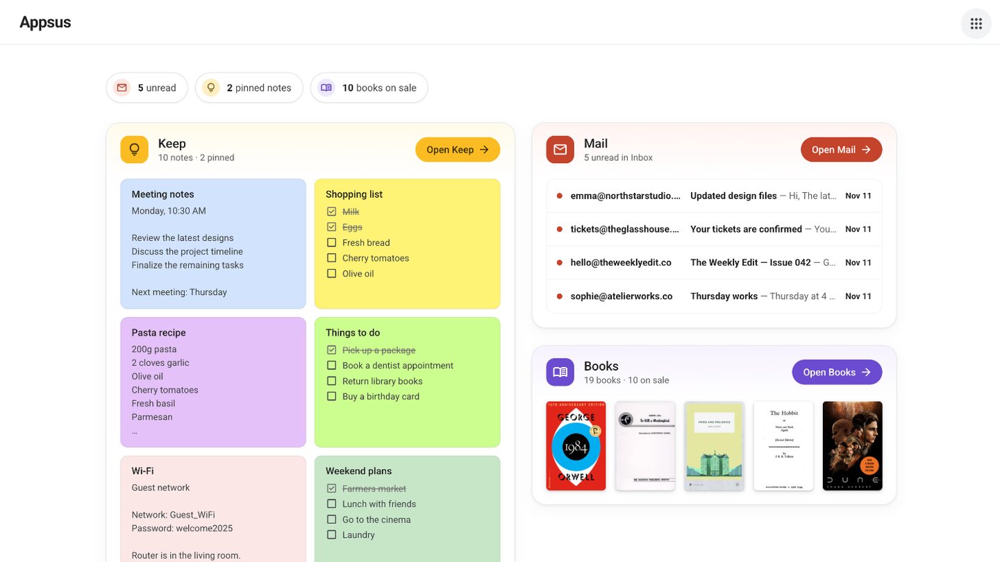
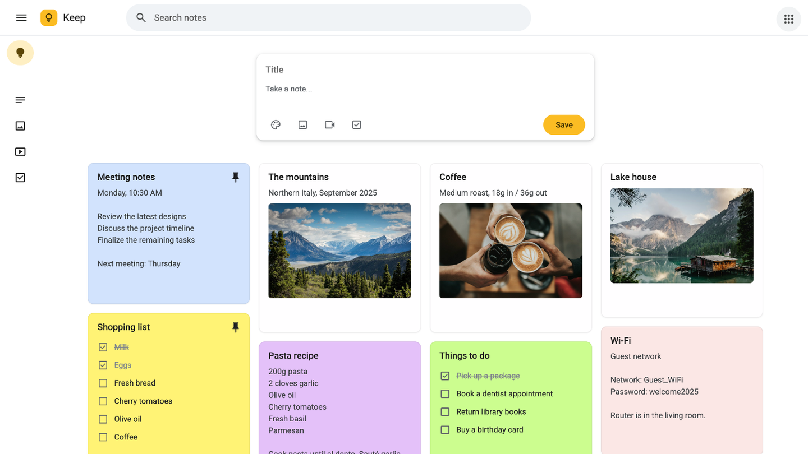
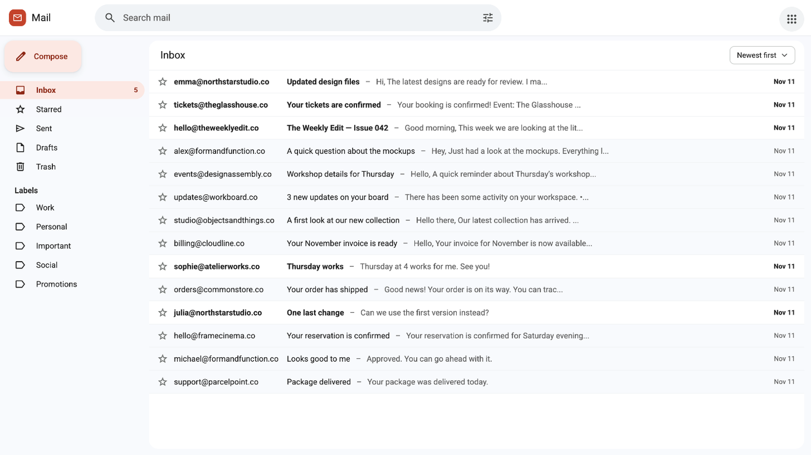
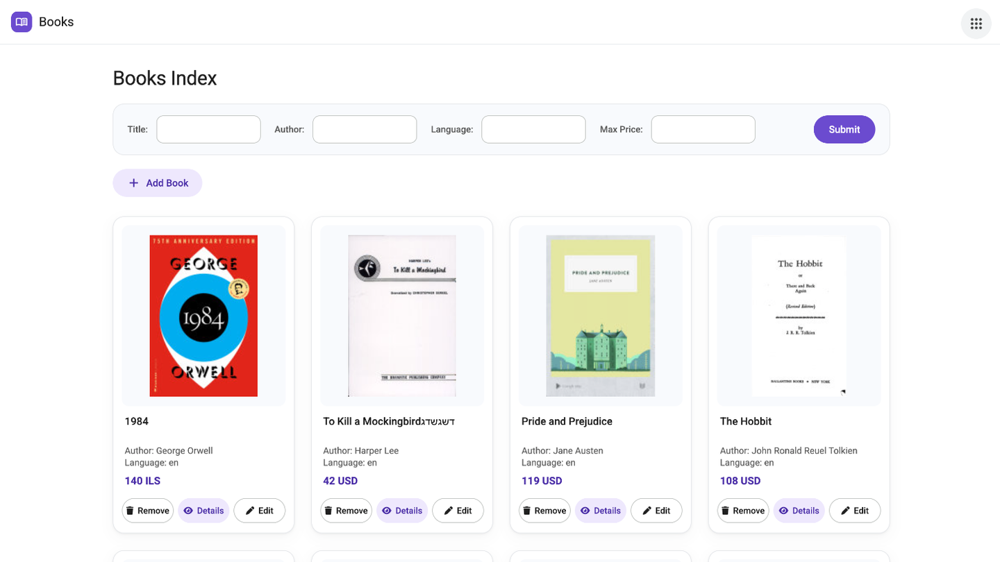

# Appsus

**Keep · Mail · Books — three apps in one workspace.**

Appsus is a React-based single-page application that brings together notes, a simulated mail client, and a book library in a unified interface.

[Live Demo](https://lironbrantz.github.io/Appsus/) · [Source Code](https://github.com/lironbrantz/Appsus)



## Applications

### Keep

Create and manage text notes, images, videos, and to-do lists. Pin or duplicate notes, change their colors, and filter by text or note type.



### Mail

Browse your inbox, sent mail, drafts, and trash. Compose messages, mark emails as read or starred, organize them with labels, and search or sort your mailbox.



### Books

Browse and filter a book collection, view book details, add or edit entries, and leave reviews. Search Google Books to expand the collection and explore category statistics in the dashboard.



## Project Highlights

- Shared navigation across all three applications.
- Integration between Keep and Mail: send a note as an email or save an email as a note.
- Reusable React components and a separate service layer.
- Responsive layouts for desktop and mobile.
- Browser-based data persistence, with sample content available on first use.

## Built With

React and JavaScript, with Chart.js for the Books dashboard and the Google Books API for book search.

## Run Locally

```bash
git clone https://github.com/lironbrantz/Appsus.git
cd Appsus
python3 -m http.server 8000
```

Open http://localhost:8000 in your browser. No npm installation or build step is required.

> **Note:** Appsus is a front-end demo. Mail messages are simulated rather than sent through a real email service, and application data is stored locally in your browser.

## Author

**Liron Brantz** — [GitHub](https://github.com/lironbrantz) · [LinkedIn](https://www.linkedin.com/in/liron-brantz-2573b13a4)
